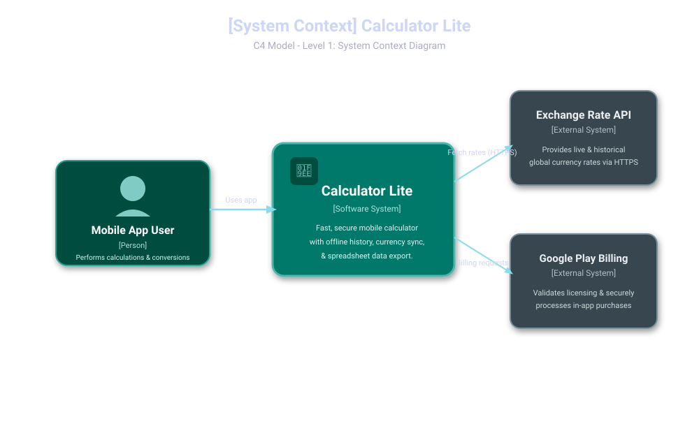
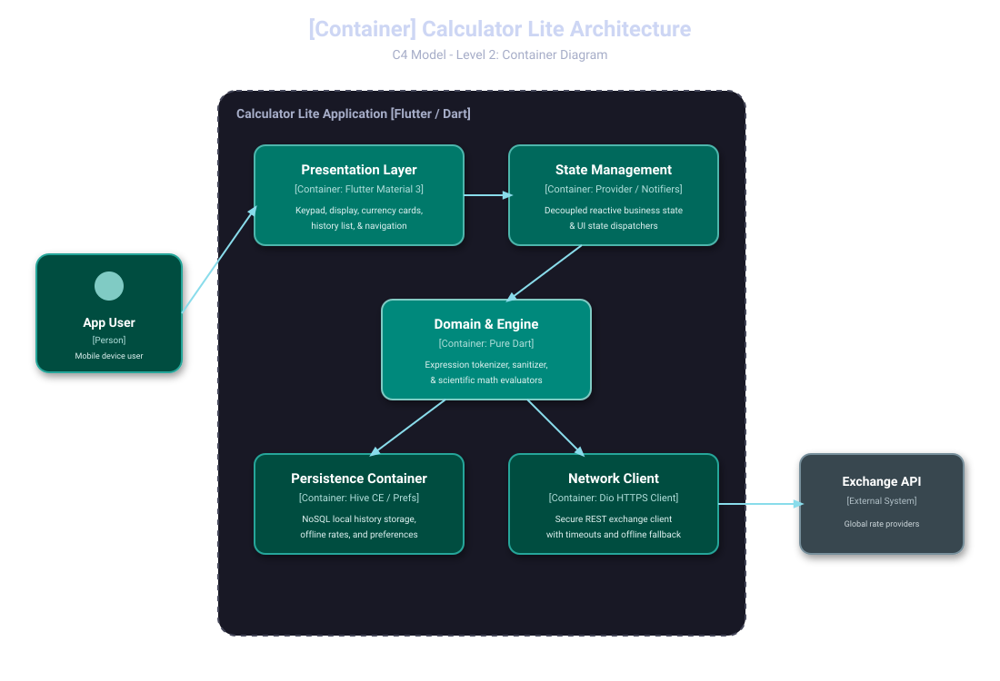
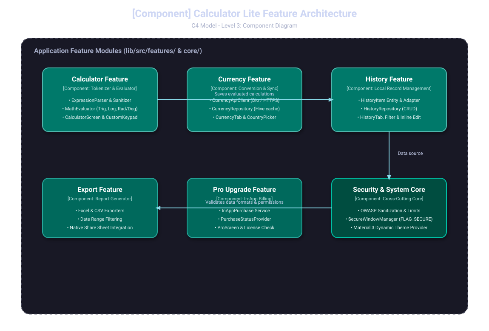
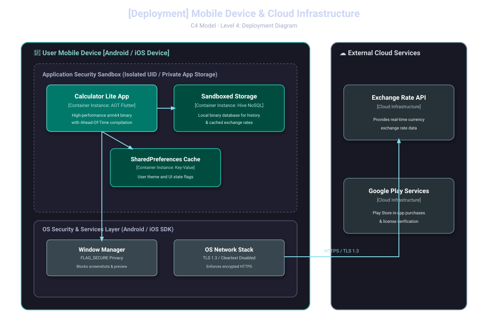

# C4 Architecture Model for Calculator Lite

This directory contains the formal C4 Architecture Model specifications for Calculator Lite, authored in Structurizr DSL and rendered into vector browser-supported graphics.

---

## 1. System Context Diagram (Level 1)
Shows the high-level boundary of Calculator Lite, primary actors, and external system integrations.

- **DSL**: [c4_context.dsl](c4_context.dsl)
- **Diagram**:

---

## 2. Container Diagram (Level 2)
Illustrates the major architectural containers within the Flutter client and their external interfaces.

- **DSL**: [c4_container.dsl](c4_container.dsl)
- **Diagram**:

---

## 3. Component Diagram (Level 3)
Examines the inner structural components across the features layer (`lib/src/features/`) and core platform utilities.

- **DSL**: [c4_component.dsl](c4_component.dsl)
- **Diagram**:

---

## 4. Deployment Diagram (Level 4)
Documents how Calculator Lite is deployed on mobile platforms (Android/iOS security sandbox, local storage, OS security layer) and its communication with cloud services.

- **DSL**: [c4_deployment.dsl](c4_deployment.dsl)
- **Diagram**:

