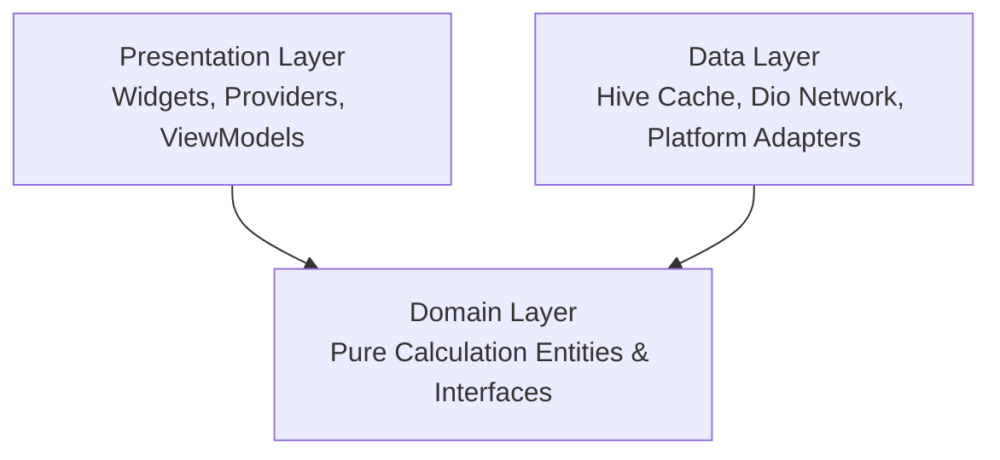

# Calculator Lite Documentation

Welcome to the official technical documentation for **Calculator Lite**, a high-performance, secure, open-source calculator and currency converter engineered with Flutter.

---

## High-Level Capabilities

- **Advanced Scientific & Basic Calculation**: Full trigonometric, logarithmic, power, factorial, percentage, and nested parenthetical operations.
- **Dynamic Real-Time Currency Conversion**: Live exchange rate fetching across 150+ global fiat currencies with offline caching.
- **Persistent Calculation History**: Local storage with search, custom naming, editing, and batch deletion.
- **Data Export**: Export calculation history to structured CSV and Excel formats.
- **Enterprise-Grade Security (OWASP Mobile Compliant)**: Sandboxed local storage, zero analytics or telemetry tracking, TLS-enforced network communication, and optional screen privacy protection (`FLAG_SECURE`).
- **Modern Responsive Design**: Adaptive Material 3 theming supporting dynamic light, dark, and OLED black modes.

---

## Architectural Pillars

- **Clean Architecture & SOLID Design**: Clear separation between UI Presentation, Domain Use Cases, and Data Repositories.
- **Complexity Guardrails**: Maximum cyclomatic complexity of 10 and cognitive complexity of 15 per routine.
- **Deterministic State Management**: Predictable state flows powered by Provider / ChangeNotifier architecture.
