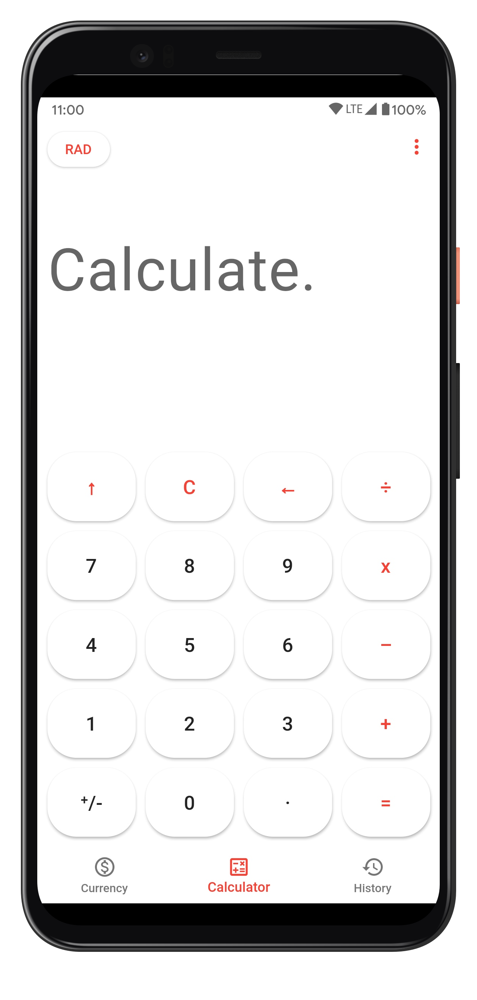
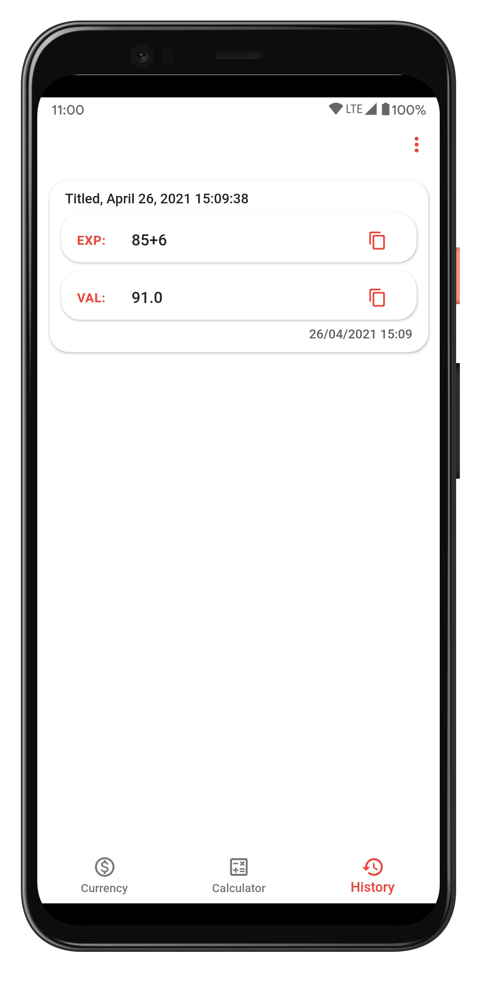
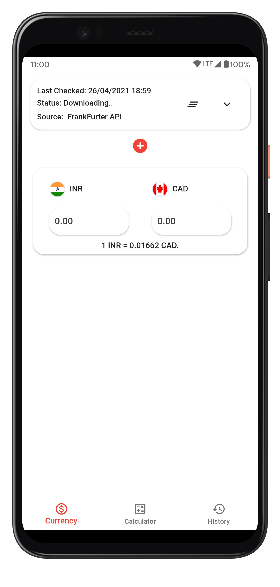
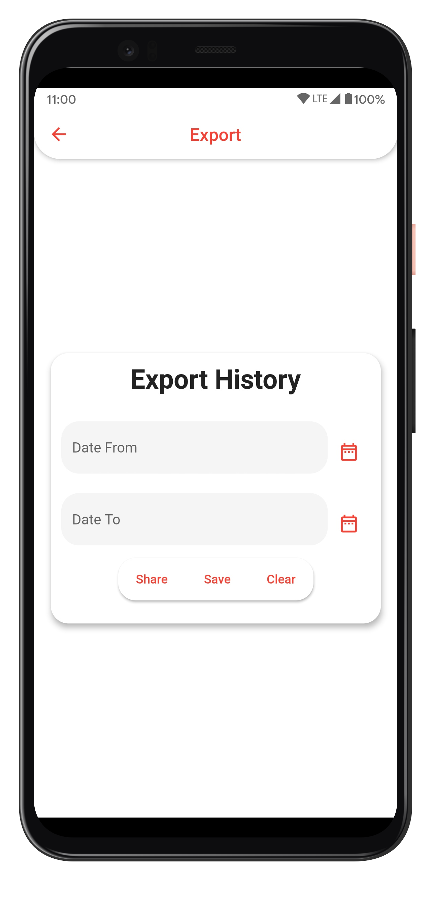
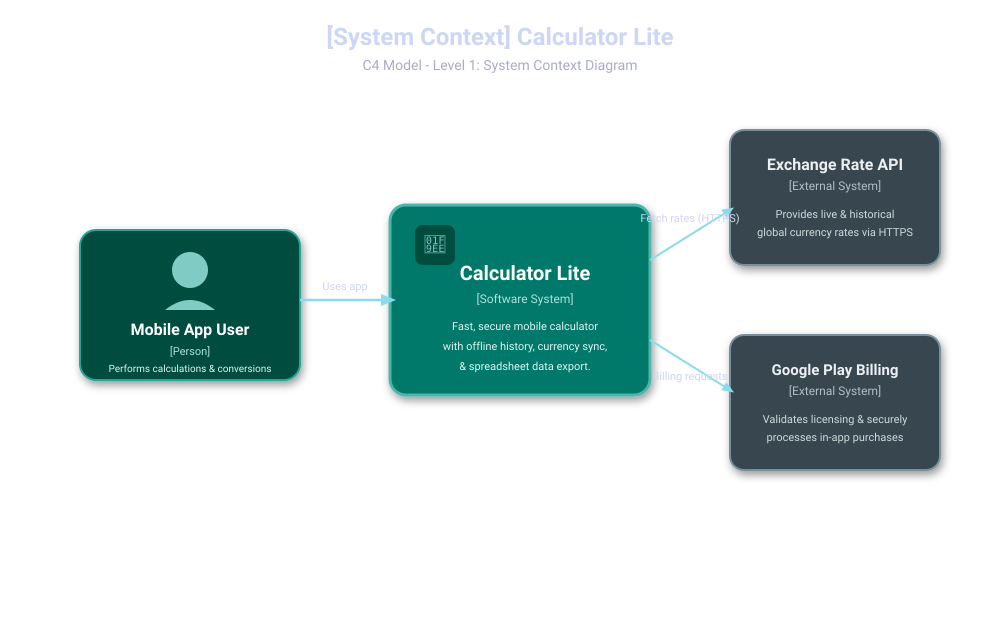
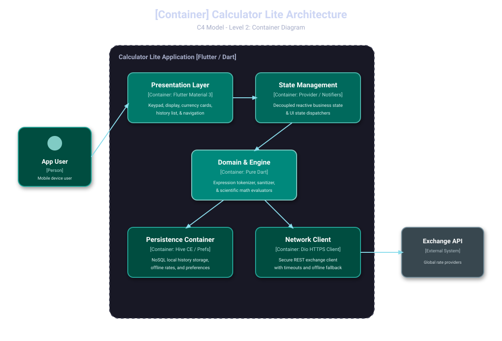
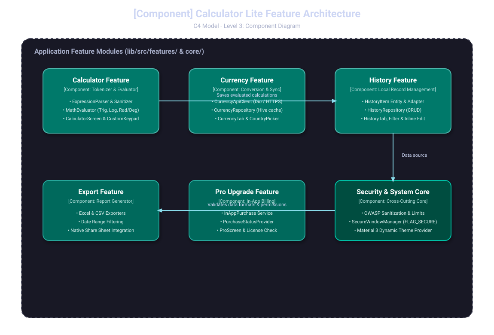
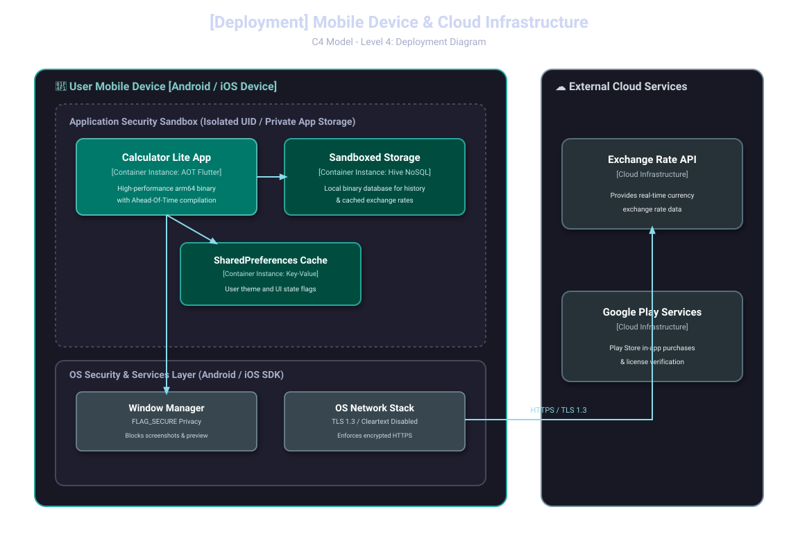

# Calculator Lite

[](https://flutter.dev)
[](https://dart.dev)
[](https://opensource.org/licenses/MIT)
[](https://conventionalcommits.org)

A modern, privacy-focused open-source calculator and currency converter built with **Flutter**.

---

## 📱 Screenshots

| Calculator Tab | History Tab |
| :---: | :---: |
|  |  |

| Currency Tab | Export Screen |
| :---: | :---: |
|  |  |

---

## 🚀 Key Features

* **Scientific & Basic Calculation Engine**: Full arithmetic, trigonometric functions (sin, cos, tan, inverse in Radian & Degree modes), logarithms, powers, factorials, roots, and percentages.
* **Foreign Exchange Converter**: Live and offline currency conversion across major world currencies with instant search and resilient local caching.
* **Persistent History**: Local NoSQL storage for past calculations with custom title editing, search, and batch clearing.
* **Multi-Format Export**: Export calculation history directly to Excel (`.xlsx`) and CSV with native share sheet integration.
* **Privacy & Local Security**: Local-only calculation engine with zero telemetry or third-party analytics, input sanitization, and optional `FLAG_SECURE` mode to prevent screenshot capture.
* **Material 3 Adaptive Design**: Responsive layout with dynamic Light, Dark, and System theming.

---

## 🏛️ C4 Architecture Diagrams

The architecture of Calculator Lite is modeled using the **C4 Model** and documented in `.docs/architecture/`.

### 1. System Context Diagram (Level 1)
Shows the high-level boundary of Calculator Lite, primary actors, and external system integrations.



### 2. Container Diagram (Level 2)
Illustrates the major architectural containers within the Flutter application and external services.



### 3. Component Diagram (Level 3)
Details the internal structure of feature modules (`lib/src/features/`) and core services.



### 4. Deployment Diagram (Level 4)
Documents the client mobile device security sandbox, local NoSQL persistence, and cloud communication.



---

## 📐 Engineering & Architecture Principles

- **SOLID Design Principles**: Single responsibility classes, open/closed operators, substitutable repository contracts, segregated interfaces, and dependency inversion.
- **Feature-First Clean Architecture**: Clean separation between **Domain** (pure Dart business logic), **Data** (Hive storage & Dio client), and **Presentation** (Material 3 widgets & reactive providers).
- **Complexity Guardrails**: Cognitive and cyclomatic complexity are kept strictly bounded; monolith methods are refactored into focused strategy delegates and token parsers.
- **Architecture Decision Records (ADRs)**: Stored in Michael Nygard format under [`.docs/adr/`](.docs/adr/).
- **AI Agent Guidelines**: Detailed operations manual and skills defined in [`AGENTS.md`](AGENTS.md) and [`.agents/`](.agents/).

---

## 🧪 Testing & Verification

Run tests and analysis locally:

```bash
# Run unit & widget test suite
flutter test

# Verify static analysis & linters
flutter analyze

# Scan codebase for PII and exposed secrets
dart run .agents/skills/conventional-commit/bin/scan_pii.dart
```

---

## 📦 Download

<a href='https://play.google.com/store/apps/details?id=com.makeshtech.calculator_lite&pcampaignid=pcampaignidMKT-Other-global-all-co-prtnr-py-PartBadge-Mar2515-1'></a>

---

## 📄 License & Credits

* Licensed under the [MIT License](LICENSE).
* Icons by [Pixel Buddha](https://www.flaticon.com/authors/pixel-buddha).
* Currency data powered by [Frankfurter API](https://www.frankfurter.app).
* Google Play and the Google Play logo are trademarks of Google LLC.
